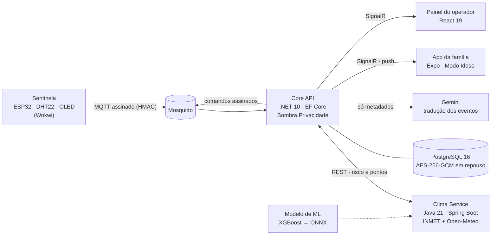

# Sombra

> **Ninguém enfrenta o calor sozinho.**
> CitizenTech da Global Solution 2026.2 · Engenharia de Software · 3º ano · FIAP

O andamento de cada parte está no [painel de status do plano](docs/PLANO.md#12-painel-de-status).

## Ficha da CitizenTech

| Campo | Conteúdo |
|---|---|
| **Nome** | Sombra |
| **Cidade e bairro** | São Paulo/SP · Moema (zona sul). Dados climáticos da estação INMET A701 (Mirante de Santana), a de referência da cidade |
| **Cidadão beneficiado** | Pessoa idosa que mora sozinha e sua rede de cuidado: família, vizinhos e agentes comunitários de saúde |
| **Problema, em uma frase** | *Em ondas de calor, idosos que moram sozinhos em São Paulo não percebem o perigo dentro de casa, e a família só fica sabendo quando já é tarde.* |
| **Como funciona** | A Sentinela (ESP32) mede o calor da casa e pede um "estou bem" num botão grande. Um modelo de ML treinado com dados reais do INMET prevê o risco das próximas 24 h. Sem resposta, o Sombra avisa a rede de cuidado em degraus, do lembrete leve ao alerta. Um motor de privacidade protege os dados de saúde e mostra um farol de Risco Cidadão. |
| **O que cada parte faz** | [tabela abaixo](#o-que-cada-parte-faz) |
| **Link do repositório** | este repositório |
| **Indicador de impacto** | Tempo mediano entre o alerta e o "estou bem" (meta < 15 min) · % de alertas resolvidos sem chegar ao último contato · % dos dias perigosos previstos com 24 h de antecedência · alarmes desnecessários para a família por semana |
| **ODS** | 3 (meta 3.d) · 10 (10.2) · 11 (11.5) · 13 (13.1) |

## O que cada parte faz

| Parte | Pasta | Disciplina | Status |
|---|---|---|---|
| Core API: domicílios, alertas, check-ins, escalonamento | [`services/core-api/`](services/core-api/) | C# Software Development | ✅ |
| Privacidade: PII, taint analysis, IA, farol de Risco Cidadão | [`services/core-api/`](services/core-api/) + [`security/`](security/) | Cybersecurity | ✅ |
| Clima Service: risco de calor, previsão de 24 h, pontos de resfriamento | [`services/clima-service/`](services/clima-service/) | SOA e Web Services | ✅ |
| Modelo de previsão de calor perigoso | [`ml/`](ml/) | IA & Machine Learning | 🚧 |
| Sentinela: ESP32 no Wokwi | [`iot/sentinela/`](iot/sentinela/) | Physical Computing | 🚧 |
| App da família e Modo Idoso | [`mobile/`](mobile/) | Mobile Development | 🚧 |
| Painel do operador e Dashboard de Risco Cidadão | [`web/painel/`](web/painel/) | (Cyber, OS e pitch) | ✅ |
| Infraestrutura Linux provisionada por scripts | [`infra/`](infra/) | Operating Systems | ✅ |
| Features e Test Cases no Azure Boards | [`qa/`](qa/) | Testing, Compliance & QA | 🚧 |
| Vídeo pitch | [`pitch/`](pitch/) | (prêmio melhor GS) | 🚧 |

## Arquitetura



O app e o painel só falam com o Core. O Core é o único que fala com o Clima, com o broker e com a IA, e nenhum dado
pessoal sai dele: a IA recebe só metadados dos eventos, e o broker, só ids e medições. Em produção, tudo roda num
servidor Ubuntu provisionado por scripts ([`infra/`](infra/)).

## Como rodar tudo

Pré-requisitos: Docker com Compose, `make`, Python 3 e `uv` (o `make doctor` confere).

```bash
make env       # cria o .env com segredos gerados na hora (nada secreto vai para o Git)
make up        # sobe banco, broker, Clima, Core e painel, e espera todos ficarem saudáveis
make sim       # uma Sentinela simulada: a casa da Dona Lurdes sobe até PERIGO e ela aperta "estou bem"
make test      # os testes de todas as partes
```

| O quê | Onde |
|---|---|
| Painel do operador | <http://localhost:5173> (`operador@demo.sombra`, senha `Demo__Senha` do `.env`) |
| Core API e OpenAPI | <http://localhost:5080/scalar/v1> (o contrato em `/openapi/v1.json`) |
| Clima Service | <http://localhost:8081/swagger-ui.html> |
| App | `cd mobile && npx expo start` ([`mobile/README.md`](mobile/README.md)) |
| Sentinela no Wokwi | `make demo-wokwi` ([`iot/sentinela/README.md`](iot/sentinela/README.md)) |
| Servidor Linux | `cd infra && vagrant up` ([`infra/README.md`](infra/README.md)) |

`make help` lista todos os alvos. Os roteiros dos vídeos estão em [`docs/videos/`](docs/videos/), e o
`make checklist` confere o que cada entrega do Teams exige.

## Documentação

- [A entrevista](docs/entrevista.md): a Dona Cida e a filha, e o que mudou no projeto por causa delas
- [O problema](docs/problema.md): o cidadão, o problema em uma frase e os indicadores
- [Rabiscos](docs/rabiscos/): telas, fluxo de dados e circuito
- [Plano mestre](docs/PLANO.md): decisões, arquitetura, fases e critérios de aceite
- [Specs por disciplina](docs/specs/)
- [Uso de IA](prompts.md): registro exigido pela GS

## Integrantes

| Nome | RM |
|---|---|
| André Nakamatsu Rocha | RM555004 |
| João Marcelo Furtado Romero | RM555199 |
| Matheus Rivera Montovaneli | RM555499 |

## Dados

Nenhum dado pessoal real. As pessoas nos dados de demonstração são fictícias e os CPFs e Cartões SUS são sintéticos.
Os dados climáticos são reais e públicos (INMET e Open-Meteo), com a fonte indicada em cada pasta.

## Licença

[MIT](LICENSE)
