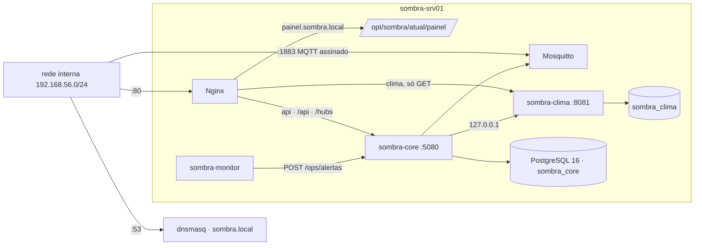

# Infraestrutura Linux (Operating Systems)

> Uma VM **vazia** vira o servidor `sombra-srv01` com o Sombra inteiro no ar, **só com scripts Bash**: hostname, IP
> estático, DNS próprio, usuários e permissões, banco, broker, os serviços como units systemd endurecidas, nginx,
> monitoramento tolerante a falhas, logs e trilha de auditoria. `vagrant destroy -f && vagrant up` reproduz tudo do zero,
> e uma segunda execução não muda nada.

**Ambiente:** Ubuntu 24.04 (`bento/ubuntu-24.04`) no VirtualBox, criado pelo [`Vagrantfile`](Vagrantfile), que só chama o
[`provision.sh`](provision.sh). Os mesmos scripts rodam em qualquer Ubuntu 24.04 (`sudo ./provision.sh`).

**Vídeo (até 7 min):** ‹link do YouTube (não listado)› · roteiro em [`docs/videos/os.md`](../docs/videos/os.md)

## Rubrica → onde está → evidência

| Critério | Pts | Como o Sombra atende | Evidência |
|---|---|---|---|
| **Provisionamento de infra** (hostname, IP, DNS) | 2 | [`10-host`](steps/10-host.sh): hostname `sombra-srv01.sombra.local`, fuso de São Paulo, NTP, locale pt-BR · [`20-rede`](steps/20-rede.sh): IP estático 192.168.56.10/24 pelo netplan e parâmetros de rede (sysctl) · [`30-dns`](steps/30-dns.sh): **dnsmasq** com a zona `sombra.local` (`api`, `clima`, `painel`) e o systemd-resolved perguntando a ele · [`40-usuarios`](steps/40-usuarios.sh): usuário de serviço `sombra` **sem shell**, grupo `sombra-ops`, sudoers mínimo (só os serviços `sombra-*`) e as pastas com dono e modo | [servidor](evidencias/01-servidor.png) |
| **Provisionamento da aplicação** | 2 | [`50-dependencias`](steps/50-dependencias.sh): PostgreSQL 16, Mosquitto, JRE 21, nginx · [`60-banco`](steps/60-banco.sh): segredos gerados na VM (0640, nunca no log), um papel e um banco por serviço e `pg_hba` fechado · [`70-aplicacao`](steps/70-aplicacao.sh): baixa o **release** e **confere o SHA256** de cada artefato, instala em `/opt/sombra/releases/<versão>`, ambiente em `/etc/sombra/*.env` (0640), broker, nginx e as [units endurecidas](systemd/) com início automático; as migrações rodam na subida | [provisionamento](evidencias/00-provisionamento.png) · [servidor](evidencias/01-servidor.png) |
| **Monitor de CPU, memória e disco com alertas** | 2 | [`sombra-monitor.sh`](monitor/sombra-monitor.sh): CPU pelo delta do `/proc/stat`, RAM pelo `MemAvailable`, disco pelo `df`, serviços (`is-active` e os `/health`), limites em [`monitor.conf`](monitor/monitor.conf); 3 verificações seguidas acima do limite viram alerta no log, no journal e um `POST` no Core, que aparece no painel "Operação" | [CPU](evidencias/falha-02-cpu-alta.png) · [memória](evidencias/falha-03-memoria-alta.png) · [disco](evidencias/falha-04-disco-cheio.png) |
| **Monitoramento como serviço tolerante a falhas** | 1 | [`sombra-monitor.service`](systemd/sombra-monitor.service): `Type=notify` com `WatchdogSec=30` (o script avisa o systemd a cada ciclo), `Restart=always`, `RestartSec=5`, limite de reinícios e habilitado no boot | [systemd](evidencias/02-systemd-monitor-auditoria.png) · [kill -9](evidencias/falha-01-matar-monitor.png) · [reboot](evidencias/falha-06-reboot.png) |
| **Logs de auditoria e execução** | 1 | [`lib/log.sh`](lib/log.sh): uma linha JSON por evento (os 8 campos do [contrato](../docs/observabilidade.md)) · [`lib/auditoria.sh`](lib/auditoria.sh): **o quê, quando, quem e o resultado** (com o código) em `/var/log/sombra/auditoria.jsonl`; o `trap ERR` registra linha, comando e código de qualquer falha; logrotate; **auditd** em `/etc/sombra`, `/opt/sombra`, nas units e no sudoers | [falha de script](evidencias/falha-07-falha-de-script.png) · [auditoria](evidencias/02-systemd-monitor-auditoria.png) |
| **Funcionamento completo** | 2 | [`90-validacao`](steps/90-validacao.sh) para o provisionamento se algo falhar: DNS, só a porta 80 aberta para a rede, os 8 serviços ativos e no boot, os `/health` pelos nomes, o painel no ar, a escrita no Clima fechada pelo nginx e o Sombra de verdade (o operador entra, lê as casas e o Core traz do Clima os pontos de resfriamento) | [provisionamento](evidencias/00-provisionamento.png) · [reprodução](evidencias/reproducao.txt) |

### Os 7 testes de falha

Cada script em [`falhas/`](falhas/) provoca a falha, espera a recuperação ou o registro e só sai com 0 se ela aconteceu.

| # | Simulação | O que acontece | Evidência |
|---|---|---|---|
| 01 | `kill -9` no monitor | o systemd o sobe de novo em ~5 s e registra no journal | [print](evidencias/falha-01-matar-monitor.png) |
| 02 | `stress-ng --cpu` | alerta crítico de CPU no log, no journal e no painel | [print](evidencias/falha-02-cpu-alta.png) |
| 03 | `stress-ng --vm` (até ~86% da RAM) | alerta de memória, e nenhum serviço cai | [print](evidencias/falha-03-memoria-alta.png) |
| 04 | `fallocate` até 93% do disco | alerta de disco e, apagado o arquivo, a volta ao normal registrada | [print](evidencias/falha-04-disco-cheio.png) |
| 05 | `kill -9` no Core | o systemd o reinicia e o `/health/ready` volta a 200 | [print](evidencias/falha-05-derrubar-api.png) |
| 06 | `reboot` da VM | todos os serviços voltam sozinhos | [print](evidencias/falha-06-reboot.png) |
| 07 | etapa de provisionamento com erro proposital | o trap grava linha, comando e código na auditoria e o provisionamento para | [print](evidencias/falha-07-falha-de-script.png) |

## Arquitetura do servidor



Os serviços escutam só em `127.0.0.1`; o nginx é a única porta HTTP para a rede. Tudo roda como `sombra` (sem shell),
com `ProtectSystem=strict`, `NoNewPrivileges`, sem capabilities e só com escrita em `/var/lib/sombra` e `/var/log/sombra`.

## Como reproduzir

Pré-requisitos no host: VirtualBox 7 e Vagrant 2.4. Na pasta `infra/`:

```bash
scripts/empacotar.sh      # (até existir um release) gera os artefatos do Core, do Clima e do painel com o SHA256SUMS
vagrant up                # cria a VM e roda o provision.sh: as 9 etapas, com a validação no fim
vagrant provision         # de novo: idempotente, não muda nada
vagrant destroy -f && vagrant up   # a prova de reprodutibilidade
scripts/reproduzir.sh     # a mesma prova, automática: do zero, provisiona de novo e confere que nada mudou
```

**Resultado registrado** ([`reproducao.txt`](evidencias/reproducao.txt), com os logs completos das
[duas](evidencias/reproducao-1-vagrant-up.log) [execuções](evidencias/reproducao-2-segunda-execucao.log)): do zero ao
Sombra no ar em 1 min 51 s, 9 etapas, 22 arquivos gravados e a validação aprovada; a segunda execução levou 10 s e
gravou **0** arquivos, com a validação aprovada de novo.

Sem `infra/artefatos/`, a etapa 70 baixa o último release do GitHub (`.github/workflows/release.yml`, publicado a cada tag
`v*`), sempre conferido pelo `SHA256SUMS`. Para fixar uma versão, `SOMBRA_RELEASE` em [`sombra.conf`](sombra.conf), que
concentra toda a configuração (hostname, IP, nomes, usuários).

Do host, os nomes respondem pelo IP da VM (no `/etc/hosts` do host, ou `curl --resolve`):

```bash
curl --resolve painel.sombra.local:80:192.168.56.10 http://painel.sombra.local/healthz
```

## Como operar

```bash
vagrant ssh
sudo systemctl status sombra-core sombra-clima sombra-monitor
sudo systemctl restart sombra-monitor           # start, stop e restart funcionam (o grupo sombra-ops tem o sudo para isso)
journalctl -u sombra-monitor -f -o cat | jq -c '{timestamp, event, message}'
sudo tail -f /var/log/sombra/auditoria.jsonl | jq -c '{quando, quem, acao, resultado}'
sudo ausearch -k sombra-config                  # quem mexeu em /etc/sombra
sudo grep DEMO_SENHA /etc/sombra/segredos.env   # a senha das contas da demo no painel
sudo falhas/02-cpu-alta.sh                      # qualquer teste de falha, de dentro da VM
```

Os prints de `evidencias/` saem de [`scripts/evidencias.sh`](scripts/evidencias.sh), numa rodada só (do host, com a VM no
ar). As bibliotecas de log e auditoria e o orquestrador têm testes num Ubuntu descartável (`make test-infra`), e todo
script passa no shellcheck no CI.

## Integrantes

| Nome | RM |
|---|---|
| André Nakamatsu Rocha | RM555004 |
| João Marcelo Furtado Romero | RM555199 |
| Matheus Rivera Montovaneli | RM555499 |
