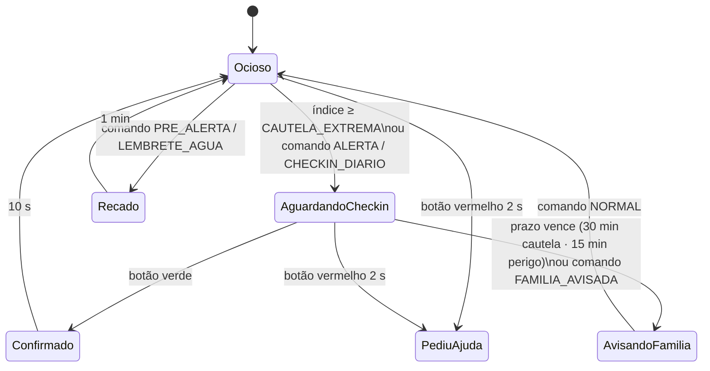

# Sentinela (Physical Computing · IoT & IoB)

> A porta física do Sombra na casa da pessoa idosa: um ESP32 que mede o calor **de dentro da casa**, calcula o índice de
> calor ali mesmo, conversa por luz fixa, 3 bipes curtos, tela e **dois botões grandes**, e fala com o Core por MQTT
> assinado nos dois sentidos. Não é um projeto paralelo: é a Sentinela `snt-7f3a9c` da casa da Dona Lurdes no seed do
> Core, a mesma que o app vincula pelo QR e que o painel acompanha ao vivo.

**Wokwi:** https://wokwi.com/projects/481162052559561729 · **Vídeo (até 4 min):** https://youtu.be/TOs7sIUAHls · roteiro em
[`docs/videos/iot.md`](../../docs/videos/iot.md) · **Integrantes:** [`integrantes.txt`](integrantes.txt)

## Circuito

| Componente | Função | Pino |
|---|---|---|
| ESP32 DevKit v1 | cérebro + Wi-Fi (`Wokwi-GUEST`) | — |
| DHT22 | temperatura e umidade da casa | GPIO 15 |
| OLED SSD1306 128×64 (I²C, 0x3C) | título grande e até 3 linhas curtas | SDA 21 · SCL 22 |
| LED RGB (catodo comum) + 3 × 220 Ω | luz **fixa**: laranja (cautela), vermelha (perigo), amarela (recado) | R 25 · G 26 · B 27 |
| Buzzer | 3 bipes curtos | GPIO 4 |
| Botão **verde** | "Estou bem" (um toque) | GPIO 18 (pull-up) |
| Botão **vermelho** | "Preciso de ajuda" (pressão longa de 2 s, contra toque acidental) | GPIO 19 (pull-up) |

O circuito está em [`diagram.json`](diagram.json) e as bibliotecas em [`libraries.txt`](libraries.txt). No simulador, a
tecla **V** aperta o verde e a **A** segura o vermelho.

### Lista de materiais (custo aproximado, varejo brasileiro, nov/2026)

| Item | Qtd. | R$ |
|---|---|---|
| ESP32 DevKit v1 | 1 | ~45 |
| DHT22 | 1 | ~25 |
| OLED SSD1306 0,96" I²C | 1 | ~25 |
| LED RGB 5 mm + 3 resistores 220 Ω | 1 | ~3 |
| Buzzer ativo 5 V | 1 | ~3 |
| Botão arcade 30 mm (verde e vermelho) | 2 | ~20 |
| Fonte USB 5 V, caixa e fios | — | ~30 |
| **Total** | | **~150** |

São estimativas de ordem de grandeza (pesquisa em lojas de componentes); o ponto do pitch é que uma Sentinela custa menos
que um mês de cuidador.

## Como ela se comporta (D13, pedido da entrevista)



- **Discreta por padrão:** no normal, luz apagada e silêncio. A luz acende **fixa, nunca piscando**, só em risco ou num
  recado do Core. São 3 bipes curtos ao entrar em risco; em perigo, eles repetem a cada 10 min (5 min no perigo extremo).
  À noite (22h–7h), só o perigo faz barulho.
- **Sempre explica o próximo passo:** "Aperte o VERDE se está tudo bem. Em 15 min: família".
- **Funciona sem internet:** o índice e o nível são calculados aqui, com a mesma fórmula e os mesmos 20 vetores do Core,
  do Clima e do ML, e ela continua alertando com luz, som e tela. Os eventos (botões, boot) entram assinados numa fila
  com o horário do toque e saem na ordem quando a rede volta; a tela mostra "sem rede, fila N". O Core só aceita
  mensagens de até 5 min (a janela anti-replay do ADR-004), então um evento mais velho sai da fila sem ser enviado, em
  vez de virar um falso ataque no dashboard de segurança. Numa queda longa, quem cuida da pessoa é o Core: sem o
  "estou bem" no prazo, ele avisa a família.

## Integração com o Core (MQTT assinado)

| Tópico | Sentido | Quando |
|---|---|---|
| `sombra/v1/snt-7f3a9c/telemetria` | Sentinela → Core | a cada 10 s e na hora em que o nível muda |
| `sombra/v1/snt-7f3a9c/evento` | Sentinela → Core | `CHECKIN_ESTOU_BEM`, `PEDIDO_DE_AJUDA`, `BOOT` |
| `sombra/v1/snt-7f3a9c/comando` | Core → Sentinela | `PRE_ALERTA`, `ALERTA`, `FAMILIA_AVISADA`, `LEMBRETE_AGUA`, `CHECKIN_DIARIO`, `NORMAL` |
| `sombra/v1/snt-7f3a9c/status` | broker → Core | `online` na conexão e `offline` pelo **LWT** se ela cair (retidos) |

O contrato é o [`mqtt.asyncapi.yaml`](../../docs/contratos/mqtt.asyncapi.yaml). Toda mensagem leva o **HMAC-SHA256** da
forma canônica com o segredo da Sentinela (ADR-004), o `seq` guardado na memória não volátil (cresce mesmo depois de
reiniciar) e o `ts` do NTP: o Core recusa assinatura errada, `seq` repetido e `ts` a mais de 5 min. O `seq` segue a
mesma regra que o Core usa nos comandos: o maior entre o último mais um e os segundos Unix de agora. Assim ele continua
crescente mesmo quando a flash é apagada, como o Wokwi faz a cada simulação. Os comandos do Core
passam pela mesma conferência na Sentinela. Nenhum dado pessoal trafega: só o `deviceId`, medições e códigos, e por isso
o broker pode ser o público (`broker.hivemq.com`, premissa P9).

**Vínculo (D17):** no boot, o OLED mostra por 8 s o QR `sombra://sentinela/vincular?v=1&d=snt-7f3a9c&c=<código>`; o app
lê e o Core confere o código antes de entregar o segredo.

## Código

| Arquivo | O que faz | Testado no host |
|---|---|---|
| [`sketch.ino`](sketch.ino) | liga o hardware e a rede à lógica: Wi-Fi, NTP, MQTT com LWT, DHT22, OLED, LED, buzzer, botões, QR (o `esp_qrcode` do core) | compilado no `arduino-cli` |
| [`indice_calor.h`](indice_calor.h) | índice de calor da NWS e os cinco níveis | os 20 vetores do contrato |
| [`hmac.h`](hmac.h) | SHA-256 e HMAC-SHA256 portáteis (o mesmo código no ESP32 e no teste) | os 6 vetores de assinatura |
| [`contrato.h`](contrato.h) | as formas canônicas assinadas (T, E, C) | idem |
| [`estado.h`](estado.h) | a máquina de estados, a luz, o bipe e a tela | 14 cenários (noite, prazo, comandos…) |
| [`fila.h`](fila.h) | a fila offline (buffer circular) | 3 cenários |
| [`config.h`](config.h) · [`secrets.h`](secrets.h) | pinos, broker, tempos · o segredo **de demonstração** | — |
| [`testes/mensagens.cpp`](testes/mensagens.cpp) · [`integrar-com-core.sh`](testes/integrar-com-core.sh) | as mensagens do firmware contra o Core de verdade | a prova de integração |

```bash
make test-sentinela            # na raiz: gera os vetores dos JSON do contrato e roda os 47 testes no g++ (também no CI)
make compilar-sentinela        # compila para o ESP32 DevKit com --warnings all (arduino-cli com o core esp32 4.0)
make integrar-sentinela        # o código do firmware → broker do compose → Core (com o make up no ar)
make integrar-sentinela-wokwi  # o mesmo pelo broker público, o caminho do Wokwi (com o make demo-wokwi no ar)
```

### A prova de integração com o Core

O [`integrar-com-core.sh`](testes/integrar-com-core.sh) monta as mensagens com os **mesmos headers do firmware**, publica
no broker e confere no log JSON do Core o que ele decidiu. O resultado fica registrado em [`evidencias/`](evidencias/):

| O que a Sentinela faz | O que o Core faz |
|---|---|
| um "estou bem" apertado sem rede há 2 min, enviado quando ela volta | aceita (`checkin.registrado`) |
| a telemetria assinada | vira leitura (`leitura.registrada`) |
| a mesma telemetria com o nível trocado de `ATENCAO` para `NORMAL` depois da assinatura | recusa (`mqtt.assinatura_invalida`) e registra no dashboard de segurança |
| a mesma telemetria outra vez | descarta como replay (`mqtt.replay_descartado`) |
| 35 °C e 50% de umidade (sente 40,7 °C) | abre o alerta e publica o comando `ALERTA` assinado (`comando.publicado`); o painel recebe a leitura e o alerta pelo SignalR com o mesmo `correlationId` da mensagem MQTT |
| o botão verde | resolve o alerta (`alerta.resolvido`) |

O comando que volta é conferido pelo mesmo código do firmware (`testes/mensagens.cpp conferir`): a assinatura do vetor
do contrato confere, e o mesmo comando com a mensagem trocada é recusado.

Ela rodou pelo broker do compose ([`localhost`](evidencias/integracao-com-core-localhost.txt)) e pelo **broker
público** ([`broker.hivemq.com`](evidencias/integracao-com-core-broker.hivemq.com.txt)), que é o caminho da Sentinela
do Wokwi.

O `secrets.h` traz o segredo dos vetores do contrato, público de propósito (o projeto do Wokwi é aberto). Para a demo, o
Core usa o mesmo em `Demo__SentinelaSegredoHex` e se conecta ao `broker.hivemq.com` (`Mqtt__Host`). Uma Sentinela real
recebe o próprio segredo no vínculo e nunca o publica.

## Rodar no Wokwi

1. Crie um projeto ESP32 em [wokwi.com](https://wokwi.com) e cole `sketch.ino`, os `.h`, `diagram.json` e
   `libraries.txt` (o editor instala as bibliotecas).
2. Na raiz, `make demo-wokwi`: sobe o ambiente com o Core no broker público (`Mqtt__Host=broker.hivemq.com`) e as
   chaves **de teste** do contrato, as mesmas do `secrets.h` (`Demo__SentinelaSegredoHex=000102…1f` e
   `Sentinela__ChaveDeVinculo=2021…3f`). `make up` volta ao normal, com as chaves do `.env`.
3. Mexa no DHT22 (clique nele): a 35 °C e 50% o índice passa de 40 °C, a luz fica vermelha fixa, ela bipa 3 vezes e
   pede o "estou bem"; o painel mostra a leitura e o alerta ao vivo. Aperte **V**: o alerta resolve.

> **Para gravar:** depois de um alerta resolvido, o Core espera **1 h** antes de abrir outro alerta na mesma casa (a
> carência do D13, para não incomodar a pessoa à toa). A Sentinela continua pedindo o "estou bem" sozinha, mas o painel
> e o app só reagem de novo depois da carência. Ensaie com folga, ou grave numa rodada só.

## Integrantes

Ver [`integrantes.txt`](integrantes.txt).
