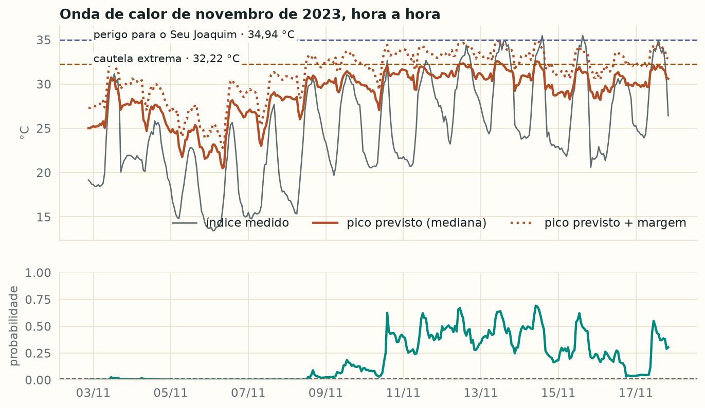

# Previsão de calor nas próximas 24 horas (ML)

Parte de **IA & Machine Learning** do [Sombra](../README.md), a CitizenTech que protege pessoas idosas que moram sozinhas
em ondas de calor. Com dados **reais** do INMET, o modelo responde:

> **Com o que a estação mediu nas últimas 24 horas, o índice de calor em São Paulo vai chegar a 32,22 °C nas próximas 24 horas?**

| Entrega | Onde |
|---|---|
| Notebook executado | [`notebooks/sombra_calor.ipynb`](notebooks/sombra_calor.ipynb) · [versão HTML](notebooks/sombra_calor.html) |
| Relatório | [`RELATORIO_ML.md`](RELATORIO_ML.md) |
| Dados e proveniência | [`dados/README.md`](dados/README.md) |
| Modelos para produção | [`modelo/`](modelo/) |
| Figuras | [`figuras/`](figuras/) |
| Vídeo (até 5 min) | a publicar (F13.6) |

## Resultado em uma frase

Entre 2022 e 2025, de cada 10 dias de calor forte, o modelo teria avisado **9,9** com até 24 horas de antecedência, ao
custo de **7,8 dias com alarme falso por mês**. Com um limiar menos sensível, avisa **9,5** de cada 10, com **3,7**.



## Rubrica

| Critério | Pontos | Evidência |
|---|---|---|
| Problema e dados reais | 2,0 | notebook, seção 1 · [`dados/README.md`](dados/README.md): fonte, link, período e SHA-256 |
| Escolha justificada do modelo | 1,0 | seções 5, 6 e 8: XGBoost contra persistência e regressão logística, com números e incerteza |
| Preparação e divisão treino/teste | 2,0 | seções 2 a 5 · `tests/test_dados.py`, `test_features.py` e `test_modelagem.py` |
| Treino com diferentes parâmetros | 2,0 | seção 6 · [`modelo/busca_hiperparametros.csv`](modelo/busca_hiperparametros.csv): 12 combinações de 3 hiperparâmetros |
| Resultados em treino e teste | 2,0 | seção 8: métricas lado a lado, matrizes, curvas, overfitting e calibração |
| Conclusão e leitura para o cidadão | 1,0 | seção 13: a frase de impacto e as limitações |

## Como rodar

Precisa de [uv](https://docs.astral.sh/uv/). Nenhuma variável de ambiente é necessária.

```bash
cd ml
make setup      # cria o .venv com as versões fixadas (Python 3.12)
make test       # testes da preparação, do treino e da exportação
make lint       # Ruff
make notebook   # executa tudo: de 2 a 6 minutos em 8 núcleos
```

Os CSVs do INMET já estão versionados. Para baixá-los de novo: `python3 -I scripts/baixar_dados.py`.

## Como está organizado

| Arquivo | Papel |
|---|---|
| `sombra_ml/dados.py` | carga dos CSVs e limpeza |
| `sombra_ml/indice_calor.py` | índice de calor, conferido pelos vetores de `docs/contratos/` |
| `sombra_ml/features.py` | catálogo de features, alvo e cálculo em janela igual ao de produção |
| `sombra_ml/modelagem.py` | divisão temporal, baselines, busca, limiar e regressor do pico |
| `sombra_ml/avaliacao.py` | dias de calor avisados, alarmes falsos e incerteza por blocos mensais |
| `sombra_ml/exportacao.py` | ONNX e contrato do `features.json` |

## O que o Clima Service recebe (F9.1)

| Arquivo em `modelo/` | Conteúdo |
|---|---|
| `modelo-calor-v1.onnx` | probabilidade de o pico das próximas 24 h alcançar 32,22 °C |
| `modelo-pico-calor-v1.onnx` | mediana do pico das próximas 24 h, em °C |
| `features.json` | ordem, janelas, fórmulas, limiares e margem |
| `paridade.csv` | 20 amostras com a saída esperada dos dois modelos |
| `paridade-janelas.json` | as observações brutas dessas amostras, para testar também o cálculo das features |
| `metricas.json` | os resultados publicados no relatório |

> **Atenção na integração.** No replay de novembro de 2023, o pico previsto fica em 32,58 °C (34,88 °C com a margem), abaixo
> dos 34,94 °C que abrem o preventivo do Seu Joaquim (D19). Use como pico o **maior valor entre a persistência e a
> mediana + margem**. O campo `probabilidadePerigo` passa a significar a chance de alcançar `CAUTELA_EXTREMA`, porque o
> nível `PERIGO` nunca ocorreu na estação.

## Integrantes

André Nakamatsu Rocha (RM555004) · João Marcelo Furtado Romero (RM555199) · Matheus Rivera Montovaneli (RM555499)
