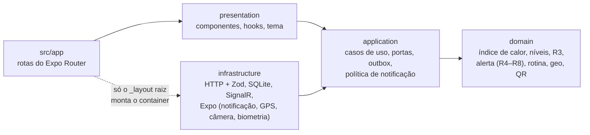
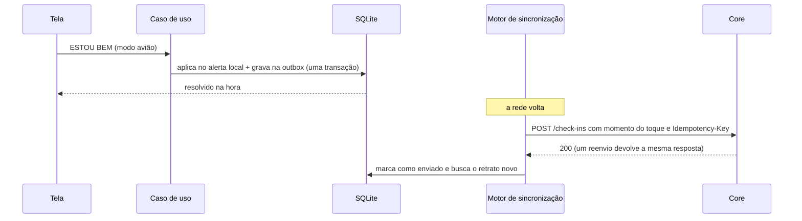

# Sombra · App (Mobile)

> A porta de entrada do **Sombra**, alerta de calor extremo para pessoas idosas que moram sozinhas, no celular de quem
> cuida e no da própria pessoa. A família acompanha a casa ao vivo, recebe o alerta em degraus e liga na hora; o
> **Modo Idoso** é uma tela só, gigante e falada, com o "ESTOU BEM". Expo SDK 58, Expo Router, TypeScript estrito,
> SQLite local-first. Disciplina **Mobile Development & IoT** · spec [`05-mobile-app.md`](../docs/specs/05-mobile-app.md)
> · fase F6 do [plano](../docs/PLANO.md).

## Ficha da CitizenTech

| Campo | Conteúdo |
|---|---|
| **Nome** | Sombra |
| **Cidade** | São Paulo/SP. Dados climáticos da estação INMET A701 (Mirante de Santana) |
| **Cidadão beneficiado** | Pessoa idosa que mora sozinha e sua rede de cuidado: família, vizinhos e agentes comunitários de saúde |
| **Problema, em uma frase** | *Em ondas de calor, idosos que moram sozinhos em São Paulo não percebem o perigo dentro de casa, e a família só fica sabendo quando já é tarde.* |
| **O papel do app** | Mostra à família o calor dentro da casa e o nível de risco **daquela pessoa**, avisa sem alarme à toa (lembrete leve antes de alarme, nada preventivo de noite) e deixa a pessoa idosa responder com um toque, mesmo sem internet |
| **Indicador de impacto** | Tempo entre o alerta e o "estou bem" (a linha do tempo de cada alerta mostra os dois horários; o Core calcula a mediana) · check-ins feitos offline que chegaram ao Core (a Central de sincronização mostra a fila) |
| **ODS** | 3 (3.d) · 10 (10.2) · 11 (11.5) · 13 (13.1) |

## Rubrica → onde está → evidência

| Critério | Como o app atende | Onde | Evidência |
|---|---|---|---|
| **Telas e navegação** | 13 telas no Expo Router com rotas tipadas: login, cinco abas da família (Início, Alertas, Perto de mim, Privacidade, Ajustes), pilha com Casa, Morador, Rotina, Sentinela, Alerta e Sincronização, e o Modo Idoso. **Guardas de rota** (`Stack.Protected`): sem sessão, todo endereço cai no Entrar; com o Modo Idoso ligado, o celular abre só na tela grande. | [`src/app/`](src/app/) | [teste do app inteiro com as rotas reais](__tests__/app-inteiro-test.tsx) · [prints](#telas) |
| **Consumo de dados** | Só fala com o Core (BFF). REST com TanStack Query e **toda resposta conferida por um schema Zod** antes de entrar no app; o erro de contrato não carrega valor nenhum (pode ser PII). `X-Correlation-Id` em toda chamada e `Idempotency-Key` nas escritas. **Tempo real** pelo hub SignalR: uma leitura de perigo deixa o card vermelho sem recarregar. **Contrato vivo:** as amostras reais gravadas pelo Core são conferidas pelos schemas do app | [`infrastructure/http/`](src/infrastructure/http/), [`eventos/projetor.ts`](src/application/eventos/projetor.ts) | [testes de HTTP](__tests__/infrastructure/http-test.ts) · [contrato com o Core](__tests__/infrastructure/contrato-do-core-test.ts) |
| **Banco de dados** | **expo-sqlite como fonte da verdade das telas** (local-first): casas, leituras de 24 h, alertas com a linha do tempo, moradores (só a forma mascarada), rede de cuidado, preferências e a **outbox**. 4 migrações versionadas (`PRAGMA user_version`), Unit of Work com transações serializadas. Toda escrita aparece na hora e vai para a outbox com backoff exponencial e dead-letter; cada retrato novo do servidor reaplica o que ainda está na fila | [`infrastructure/database/`](src/infrastructure/database/), [`application/sincronizacao/`](src/application/sincronizacao/) | [repositórios com SQL real](__tests__/infrastructure/repositorios-test.ts) · [motor de sincronização](__tests__/infrastructure/sincronizacao-test.ts) · [Central de sincronização](#telas) |
| **Acessibilidade** | Atkinson Hyperlegible, contraste ≥ 4,5:1 conferido nos dois temas, toque ≥ 48 dp (≥ 120 dp no Modo Idoso), o nível **nunca só pela cor** (cor + ícone + texto), voz em pt-BR e vibração no Modo Idoso, a seta do "Perto de mim" também em palavras, o pedido de ajuda só com toque longo | [`presentation/componentes/`](src/presentation/componentes/), [`idoso.tsx`](src/app/idoso.tsx) | [checklist](#acessibilidade) |
| **Aderência ao problema** | A régua é a entrevista (D13): **lembrete leve** nos degraus 1 e 2, alarme só no 3 ou no pedido de ajuda, nada preventivo de noite. Risco personalizado (R3) explicado na tela: "por que a Lurdes está em risco". Replay da onda de calor **real** de nov/2023 (INMET A701, SHA-256 conferido no CI). Fila offline do "estou bem", que vale o horário do toque. Pontos de resfriamento com GPS e bússola. Vínculo da Sentinela por QR. Centro de Privacidade (LGPD, art. 18) | [`domain/`](src/domain/), [`notificacoes/politica.ts`](src/application/notificacoes/politica.ts) | [máquina de estados do alerta](__tests__/domain/alerta-test.ts) · [replay real](__tests__/replay-inmet-test.tsx) · [rotina e Sentinela](__tests__/rotina-e-sentinela-test.tsx) |
| **Documentação** | Este README, a [spec](../docs/specs/05-mobile-app.md), o [contrato do Core](../docs/contratos/core-api.md) e o do [tempo real](../docs/contratos/signalr.md) | aqui | — |

## Arquitetura



O **domínio é TypeScript puro**, sem React nem Expo: value objects com fábrica e `Result`, relógio injetável e a
máquina de estados do alerta. O índice de calor passa nos 20 vetores do contrato, os mesmos do Core, do Clima e da
Sentinela. Um [teste de arquitetura](__tests__/arquitetura-test.ts) quebra se uma camada importar o que não pode.

**Local-first**, o caminho de um "estou bem" sem internet:



## Telas

> 📷 Os prints entram aqui (F6.8), tirados no celular com o modo demonstração.

| Tela | Rota | O que mostra |
|---|---|---|
| Entrar | `(auth)/entrar` | login no Core ou "Ver com dados de exemplo" |
| Início | `(abas)/index` | um card por casa: farol (cor + ícone + texto), índice de calor, último "estou bem", Sentinela online e a pílula do que espera a internet |
| Casa | `casa/[id]` | gráfico de 24 h, "por que ela está em risco" (R3), alerta aberto, rede de cuidado com "Ligar" |
| Alertas | `(abas)/alertas` | ativos primeiro, com a contagem até o próximo degrau; resolvidos embaixo |
| Alerta | `alerta/[id]` | linha do tempo do escalonamento, "Vou ligar" e "Ela está bem" |
| Perto de mim | `(abas)/perto` | pontos de resfriamento por distância, com a seta da bússola e a direção em palavras |
| Privacidade | `(abas)/privacidade` | farol de Risco Cidadão da casa com a mensagem traduzida e o Centro de Privacidade (exportar e apagar os dados do celular) |
| Ajustes | `(abas)/ajustes` | Modo Idoso neste celular, tamanho do texto, bloqueio por digital, Central de sincronização e os controles da demonstração |
| Morador | `casa/[id]/morador` | cadastro com CPF, Cartão SUS e saúde sempre mascarados |
| Rotina | `casa/[id]/rotina` | check-in diário e lembrete de água (nunca entre 22h e 7h) |
| Sentinela | `casa/[id]/sentinela` | vínculo pelo QR (câmera) ou digitando o código |
| Sincronização | `sincronizacao` | o que espera a internet, o que o Core recusou (reenviar ou descartar) e "simular sem internet" |
| Modo Idoso | `idoso` | temperatura gigante, ESTOU BEM, PRECISO DE AJUDA (toque longo), voz |

## Acessibilidade

Checklist da [spec](../docs/specs/05-mobile-app.md#acessibilidade-checklist-com-prints-no-readme):

| Item | Situação |
|---|---|
| `accessibilityLabel`, `accessibilityRole` e `accessibilityHint` em todo elemento tocável | ✅ a dica é obrigatória no tipo do `Botao` e do `BotaoGigante`, e um [teste](__tests__/acessibilidade-test.tsx) percorre botões, rádios, caixas e interruptores das telas com formulário |
| Área de toque ≥ 48 dp (≥ 120 dp no Modo Idoso) | ✅ `toque.minimo` e `toque.idoso` dos tokens de design |
| Contraste ≥ 4,5:1, com Atkinson Hyperlegible | ✅ [`design/tokens.py conferir`](../design/tokens.py) confere os pares dos dois temas no CI |
| Respeita a fonte do sistema **+** controle de tamanho no app | ✅ o texto acompanha a fonte do sistema e, por cima, o **Tamanho do texto** de Ajustes (Normal, Grande 1,2×, Maior 1,4×), gravado no aparelho. O número gigante fica fora da escala do app para caber na tela |
| O farol nunca depende só da cor | ✅ cor + ícone + texto em todo nível, também no rótulo do leitor de tela |
| Testado com TalkBack | ⬜ vídeo curto de evidência (F6.7) |
| Modo Idoso lê a situação em voz alta e vibra ao confirmar | ✅ `expo-speech` em pt-BR e `expo-haptics` |
| Respeita "reduzir movimento" | ✅ o app não tem animação própria; as transições são as nativas do sistema |

## Como rodar

Precisa de Node 22 e do **Expo Go** (SDK 58) no celular.

```bash
cd mobile
npm ci
npx expo start            # lê o QR com o Expo Go
```

**Sem backend:** na tela de entrada, toque em **"Ver com dados de exemplo"**. O app abre com duas casas fictícias e um
aviso claro de demonstração. Em Ajustes ficam:
- **"Reproduzir a onda de calor real"** (nov/2023): o índice chega a 35,5 °C, *Cautela extrema* pela régua da NWS.
- **"Simular onda de calor"**: uma leitura sintética de perigo, rotulada como simulação, para o card ficar vermelho.
- **"Usar neste celular"**: liga o Modo Idoso.

**Com o Core:** na raiz, `make env && make up` (veja o [README do Core](../services/core-api/README.md)). As contas da
demonstração estão lá; a senha é o `Demo__Senha` do `.env`. O Core escuta só em `127.0.0.1:5080`, então:

| Onde o app roda | `EXPO_PUBLIC_API_URL` |
|---|---|
| Emulador Android | `http://10.0.2.2:5080` |
| Celular Android no USB | `http://localhost:5080`, depois de `adb reverse tcp:5080 tcp:5080` |
| VM do Vagrant (F8) | `http://192.168.56.10:5080` (o perfil `preview` do `eas.json`) |

```bash
EXPO_PUBLIC_API_URL=http://10.0.2.2:5080 npx expo start
make sim CENARIO=onda-de-calor      # na raiz: a Sentinela simulada manda a leitura, e o card fica vermelho ao vivo
make vinculo DEVICE=snt-abc123      # na raiz: imprime o QR de vínculo para a tela da Sentinela
```

### Variáveis

| Variável | Para quê | Padrão |
|---|---|---|
| `EXPO_PUBLIC_API_URL` | URL do Core, validada pelo Zod na carga ([`config.ts`](src/infrastructure/config.ts)) | `http://localhost:5080` |
| `EAS_PROJECT_ID` | Só para gerar o APK pelo EAS ([`app.config.js`](app.config.js)); fora do repositório de propósito | — |

### Qualidade

```bash
npm run lint              # ESLint (expo)
npm run typecheck         # tsc --noEmit, estrito com noUncheckedIndexedAccess
npm test                  # 325 testes Jest, em 22 suítes
npm run test:cobertura    # com o gate de 95% (statements, linhas e funções) e 90% (branches)
npx expo-doctor
```

**Cobertura:** 97,7% statements · 98,5% linhas · 95,9% funções · 91,3% branches. Os testes rodam o composition root
de verdade sobre um SQLite real (`sql.js`), com o gateway de demonstração no lugar do Core e um interruptor de modo
avião. Ficam **fora da conta, de propósito**, os adaptadores nativos (`infrastructure/native`, `expo-sqlite`, o
container do aparelho), que só rodam no celular.

O CI roda tudo isso, confere o replay do INMET contra o SHA-256 do manifesto e gera o bundle Hermes de Android.

## Limitações conhecidas

- **Sincronização em segundo plano:** só no APK. No Expo Go do Android o `TaskManager` não existe, e a Central mostra
  "não disponível" em vez de fingir.
- **Face ID:** não roda no Expo Go do iOS; no Android, a digital funciona.
- **Replay real:** nenhuma hora da A701 em nov/2023 chega a *Perigo* pela régua da NWS. Para quem tem cardiopatia e
  toma diurético (R3), o mesmo pico já é *Perigo*.
- **APK:** sem o `EXPO_TOKEN` nos secrets, a entrega é pelo Expo Go.

## Integrantes

| Nome | RM |
|---|---|
| André Nakamatsu Rocha | RM555004 |
| João Marcelo Furtado Romero | RM555199 |
| Matheus Rivera Montovaneli | RM555499 |

Nenhum dado pessoal real: as casas e as pessoas da demonstração são fictícias, e os documentos são sintéticos.
