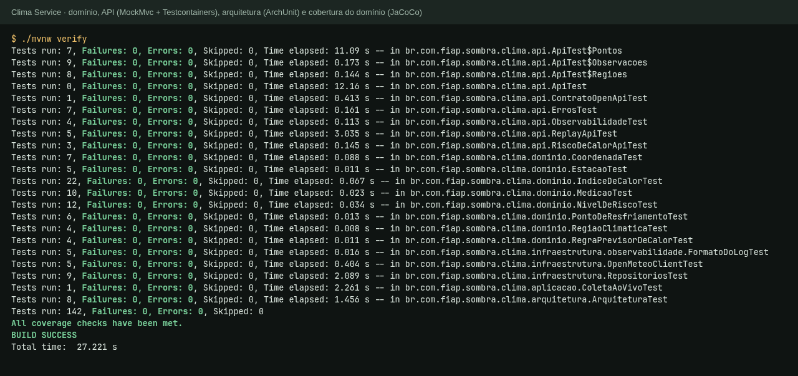
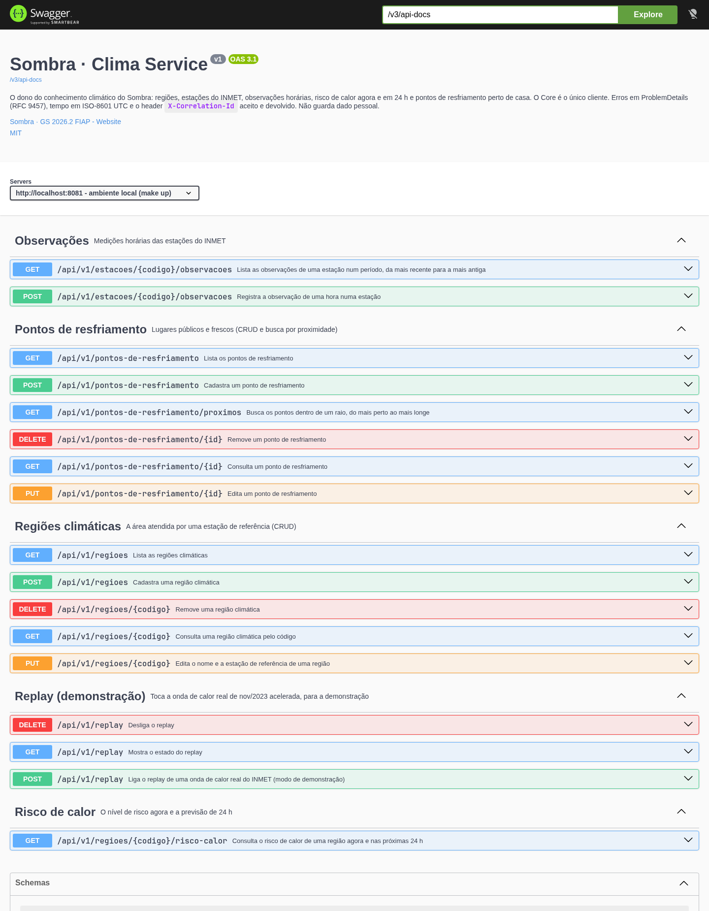
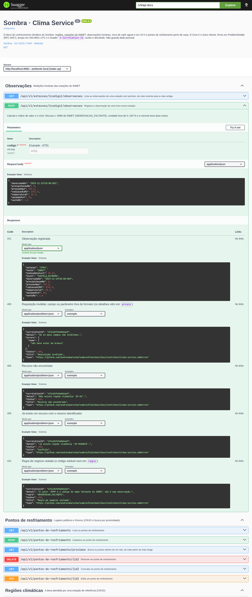
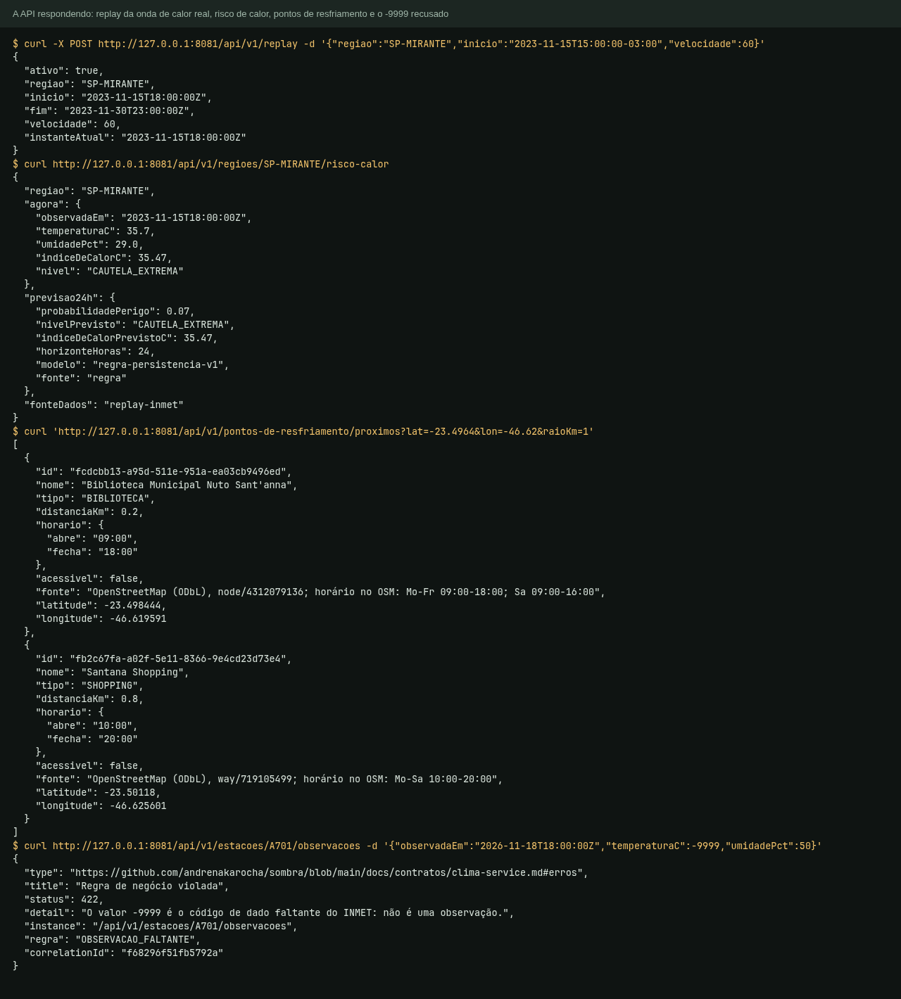
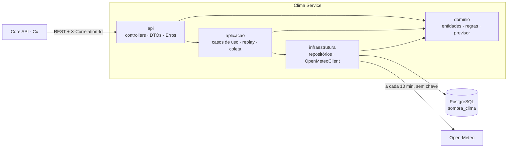
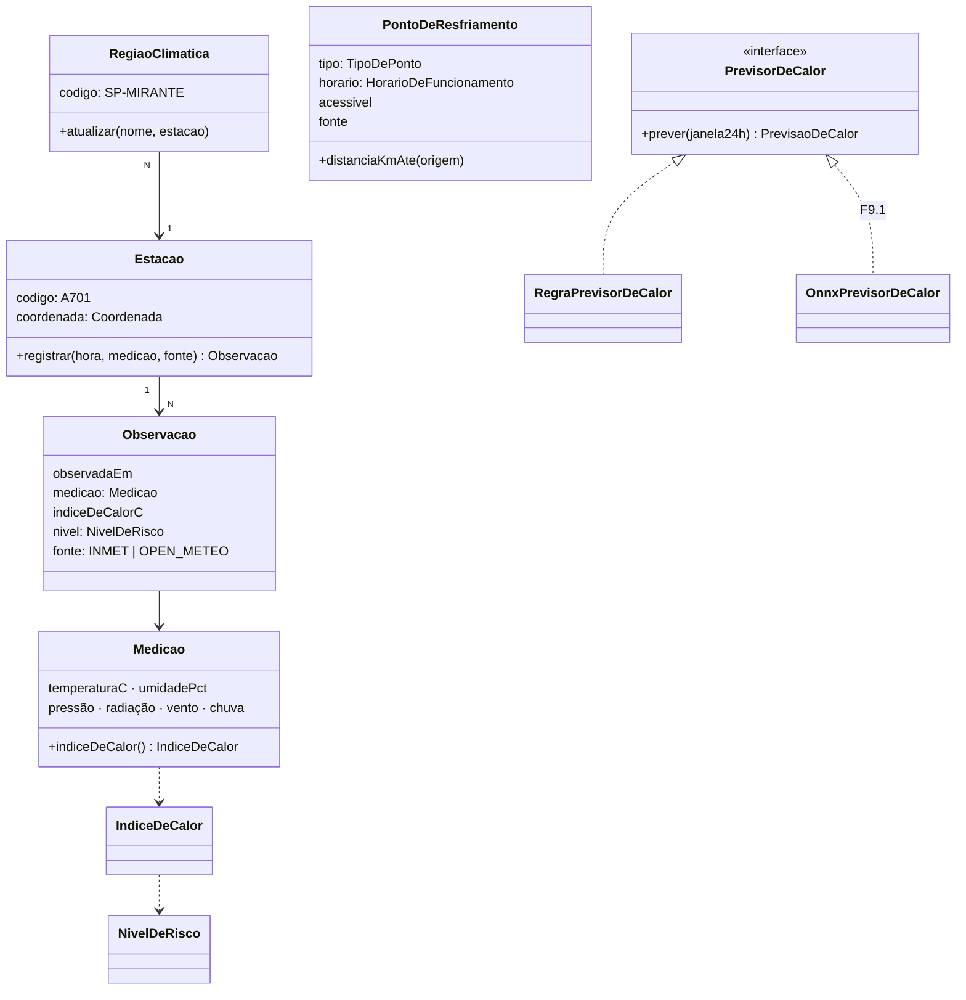

# Clima Service (SOA e Web Services)

> O serviço **dono do conhecimento climático** do Sombra: regiões, estações do INMET, observações horárias, risco de
> calor agora e em 24 h e pontos de resfriamento perto de casa. Java 21 · Spring Boot 3.5 · PostgreSQL 16 · Flyway ·
> springdoc. O Core (C#) é o único cliente e fala com ele só pelo contrato OpenAPI, nunca pelo banco.

## Ficha da CitizenTech

| Campo | Conteúdo |
|---|---|
| **Nome** | Sombra |
| **Cidade e bairro** | São Paulo/SP · zona norte (estação INMET A701, Mirante de Santana) |
| **Cidadão beneficiado** | Pessoa idosa que mora sozinha e a rede de cuidado dela: família, vizinhos e agentes comunitários de saúde |
| **Problema, em uma frase** | *Em ondas de calor, idosos que moram sozinhos em São Paulo não percebem o perigo dentro de casa, e a família só fica sabendo quando já é tarde.* |
| **Como funciona** | A Sentinela (ESP32) mede o calor da casa e pede um "estou bem". **Este serviço** diz qual é o risco de calor da região agora e nas próximas 24 h e onde fica o lugar fresco mais perto. Sem resposta da pessoa, o Core avisa a rede de cuidado em degraus |
| **O que cada parte faz** | [README da raiz](../../README.md#o-que-cada-parte-faz) |
| **Link do repositório** | [github.com/andrenakarocha/sombra](https://github.com/andrenakarocha/sombra) (esta pasta: `services/clima-service/`) |
| **Indicador de impacto** | % dos dias perigosos previstos com 24 h de antecedência · tempo mediano entre o alerta e o "estou bem" (meta < 15 min) |
| **ODS** | 3 (meta 3.d) · 10 (10.2) · 11 (11.5) · 13 (13.1) |

## Autoavaliação do guia → onde está → evidência

Os 22 subitens da autoavaliação do guia do professor, cada um com o código e a evidência. **Soma: 10,0 / 10.**

| Critério | Subitem | Pts | Onde está | Evidência |
|---|---|---|---|---|
| **Domínio** (3,0) | Entidades e nomes vêm do problema | 0,5 | `RegiaoClimatica`, `Estacao`, `Observacao`, `Medicao`, `IndiceDeCalor`, `NivelDeRisco`, `PrevisaoDeCalor`, `PontoDeResfriamento`, `HorarioDeFuncionamento` em [`dominio/`](src/main/java/br/com/fiap/sombra/clima/dominio/) | [diagrama](#domínio) |
| | Camadas domínio · aplicação · infraestrutura · api | 0,75 | um pacote por camada; o [`ArquiteturaTest`](src/test/java/br/com/fiap/sombra/clima/arquitetura/ArquiteturaTest.java) (ArchUnit) quebra o build se uma seta for violada | [testes](docs/evidencias/testes.png) (8 regras de arquitetura) |
| | ≥ 2 regras no domínio, fora do controller e do SQL | 0,75 | **13 regras**, cada uma com código estável no 422: `-9999` do INMET não é observação, umidade 0–100 %, temperatura −40 a 60 °C, índice de calor (Rothfusz, 20 vetores do contrato), classificação NWS, região exige estação válida, ponto abre antes de fechar e sempre com fonte, período de no máximo 31 dias, raio de até 20 km… | [contrato: Erros](../../docs/contratos/clima-service.md#erros) · 70 testes de domínio |
| | DTOs com validação; a entidade não vaza no JSON | 0,5 | `record`s com Bean Validation em [`api/`](src/main/java/br/com/fiap/sombra/clima/api/); duas regras ArchUnit garantem que nenhum controller devolve e nenhum DTO carrega uma entidade | [400 com `errors` por campo](docs/evidencias/swagger-erros.png) |
| | ≥ 1 relacionamento | 0,5 | `Estacao 1—N Observacao` e `RegiaoClimatica N—1 Estacao` (`@ManyToOne`) | [diagrama](#domínio) |
| **Banco** (3,0) | Banco relacional de verdade | 0,75 | PostgreSQL 16 (`sombra_clima`), com um papel só dele (o Core não entra) | [migracoes.png](docs/evidencias/migracoes.png) |
| | Conexão por variável de ambiente + `.env.example` | 0,5 | `SPRING_DATASOURCE_*` no compose; fora dele, `CLIMA_DB_PASSWORD` do `.env` (fora do Git), com o [`.env.example`](../../.env.example) versionado | [`application.yml`](src/main/resources/application.yml) |
| | CRUD de ≥ 1 entidade | 0,75 | CRUD completo de **`RegiaoClimatica`** e de **`PontoDeResfriamento`** | [api.png](docs/evidencias/api.png) · [`ApiTest`](src/test/java/br/com/fiap/sombra/clima/api/ApiTest.java): 24 testes de status e corpo |
| | Relacionamento com FK | 0,5 | `observacao.estacao_codigo → estacao.codigo` e `regiao_climatica.estacao_codigo → estacao.codigo` | [migracoes.png](docs/evidencias/migracoes.png) (as duas FK) |
| | ≥ 1 consulta além do CRUD | 0,5 | observações por período `[de, ate)`, da mais recente à mais antiga, paginadas · pontos dentro de um raio, ordenados por distância (haversine em SQL com filtro por caixa) · a observação "agora" e a janela de 24 h | [`ObservacaoRepository`](src/main/java/br/com/fiap/sombra/clima/infraestrutura/ObservacaoRepository.java), [`PontoDeResfriamentoRepository`](src/main/java/br/com/fiap/sombra/clima/infraestrutura/PontoDeResfriamentoRepository.java) |
| **Migrações** (1,5) | Ferramenta de migração, sem auto-DDL | 0,5 | Flyway + `ddl-auto=validate` (o Hibernate só confere) | [migracoes.png](docs/evidencias/migracoes.png) |
| | ≥ 2 migrações (criação + evolução) | 0,5 | [V1](src/main/resources/db/migration/V1__cria_estacao_regiao_e_observacao.sql) cria estação, região e observação · [V2](src/main/resources/db/migration/V2__cria_ponto_de_resfriamento.sql) cria o ponto · [V3](src/main/resources/db/migration/V3__ponto_com_horario_acessibilidade_e_fonte.sql) **evolui** o ponto (horário, acessibilidade e fonte, com preenchimento antes do `NOT NULL`) | [migracoes.png](docs/evidencias/migracoes.png) |
| | Dados carregados por migração | 0,25 | [V4](src/main/resources/db/migration/V4__seed_mirante_nov_2023.sql): a região SP-MIRANTE, a A701, **637 horas reais** da onda de calor de nov/2023 e **9 pontos reais** do OpenStreetMap, gerados por [`gerar_seed.py`](scripts/gerar_seed.py) | [migracoes.png](docs/evidencias/migracoes.png) |
| | README com o comando que cria o banco | 0,25 | [Como rodar](#como-rodar) | — |
| **Documentação** (1,5) | OpenAPI gerada do código, numa URL | 0,5 | springdoc: [`/swagger-ui.html`](http://localhost:8081/swagger-ui.html) e `/v3/api-docs`, versionada em [`clima-service.openapi.json`](../../docs/contratos/clima-service.openapi.json) | [swagger.png](docs/evidencias/swagger.png) |
| | Resumo e tag em todo endpoint | 0,25 | 17 operações em 5 tags; o [`ContratoOpenApiTest`](src/test/java/br/com/fiap/sombra/clima/api/ContratoOpenApiTest.java) falha se faltar um | [swagger.png](docs/evidencias/swagger.png) |
| | Modelos com exemplo | 0,25 | `@Schema(example = …)` em todo campo de todo DTO | [swagger-erros.png](docs/evidencias/swagger-erros.png) |
| | Erros documentados (400, 404, 422…) | 0,25 | `@ErrosDocumentados` vira, em cada endpoint, a resposta com o corpo `Problema` (RFC 9457) e um exemplo; o teste confere os 4xx em todas as operações | [swagger-erros.png](docs/evidencias/swagger-erros.png) (201, 400, 404, 409, 422) |
| | README com link e print da doc | 0,25 | [Documentação](#documentação-da-api) | [swagger.png](docs/evidencias/swagger.png) |
| **Testes** (1,0) | Testes de unidade do domínio, sem banco e sem HTTP | 0,4 | 70 testes em [`dominio/`](src/test/java/br/com/fiap/sombra/clima/dominio/), incluindo os 20 vetores do índice de calor lidos do contrato; JaCoCo exige 90% das linhas do domínio | [testes.png](docs/evidencias/testes.png) |
| | ≥ 1 teste de API (status + corpo) | 0,3 | MockMvc contra o PostgreSQL real do **Testcontainers**: [`ApiTest`](src/test/java/br/com/fiap/sombra/clima/api/ApiTest.java), [`RiscoDeCalorApiTest`](src/test/java/br/com/fiap/sombra/clima/api/RiscoDeCalorApiTest.java), [`ReplayApiTest`](src/test/java/br/com/fiap/sombra/clima/api/ReplayApiTest.java), [`ObservabilidadeTest`](src/test/java/br/com/fiap/sombra/clima/api/ObservabilidadeTest.java) | [testes.png](docs/evidencias/testes.png) |
| | Um comando roda tudo, no README, com print | 0,3 | `./mvnw verify` (ou `make test-clima` na raiz), também no CI a cada PR | [testes.png](docs/evidencias/testes.png) |

## Como rodar

Pré-requisitos: Docker com Compose e JDK 21 (o `./mvnw` baixa o Maven). Na raiz do repositório:

```bash
make env                 # cria o .env com as senhas geradas (nunca vai para o Git)
make up                  # PostgreSQL, Core, Clima e o resto; o Clima migra o banco dele ao subir
```

**Criar o banco do zero, só com as migrações** (sem subir a aplicação):

```bash
docker compose up -d db                                      # PostgreSQL vazio (os bancos e papéis por serviço)
set -a && . ./.env && set +a                                 # a senha vem do .env
cd services/clima-service && ./mvnw flyway:migrate           # aplica V1, V2, V3 e V4 em sombra_clima
```

Ou `make db-reset`, que apaga o volume e recria os bancos do Core e do Clima. Para rodar só o Clima fora do compose:
`cd services/clima-service && ./mvnw spring-boot:run` (lê o `.env` da raiz e migra ao subir).

**Testes:**

```bash
cd services/clima-service && ./mvnw verify    # domínio, API (Testcontainers), arquitetura, contrato OpenAPI e cobertura
```



| Comando | O que faz |
|---|---|
| `make test-clima` | o mesmo `./mvnw verify`, da raiz |
| `make openapi-clima` | regenera `docs/contratos/clima-service.openapi.json` a partir do código |
| `python3 -I services/clima-service/scripts/gerar_seed.py` | regenera a V4 a partir do CSV do INMET (conferido pelo SHA-256) e dos pontos do OSM |
| `services/clima-service/scripts/evidencias.sh` | refaz os prints de `docs/evidencias/` com o ambiente no ar |

## Documentação da API

Gerada do código pelo springdoc: **<http://localhost:8081/swagger-ui.html>** (contrato em `/v3/api-docs`).



Cada endpoint documenta os erros dele, com o corpo `Problema` (RFC 9457) e um exemplo:



## Endpoints

Base `/api/v1`. Erros em ProblemDetails pt-BR com `correlationId`; o `X-Correlation-Id` do Core é aceito e devolvido.

| Método | Rota | O que faz |
|---|---|---|
| GET · POST | `/regioes` | lista (paginado) e cadastra regiões climáticas |
| GET · PUT · DELETE | `/regioes/{codigo}` | consulta, edita e remove |
| GET | `/regioes/{codigo}/risco-calor` | o nível agora e a previsão de 24 h (503 sem observação nas últimas 3 h) |
| POST | `/estacoes/{codigo}/observacoes` | registra a observação de uma hora (recusa o `-9999`) |
| GET | `/estacoes/{codigo}/observacoes?de=&ate=&pagina=&tamanho=` | observações num período, da mais recente à mais antiga |
| GET · POST | `/pontos-de-resfriamento` | lista (paginado) e cadastra pontos |
| GET · PUT · DELETE | `/pontos-de-resfriamento/{id}` | consulta, edita e remove |
| GET | `/pontos-de-resfriamento/proximos?lat=&lon=&raioKm=` | os pontos dentro do raio, do mais perto ao mais longe |
| GET · POST · DELETE | `/replay` | mostra, liga e desliga o replay da onda de calor real de nov/2023 (demonstração) |
| GET | `/actuator/health/liveness` · `/actuator/health/readiness` · `/actuator/info` | vivo, pronto (banco e previsor) e versão |



## Arquitetura



As setas são as únicas dependências permitidas, e o [`ArquiteturaTest`](src/test/java/br/com/fiap/sombra/clima/arquitetura/ArquiteturaTest.java)
as garante. Como no guia do professor, a aplicação chama os repositórios da infraestrutura, e o domínio só conhece o
mapeamento JPA (metadado), nunca o Spring, o HTTP ou o SQL.

### Domínio



### O risco e a previsão

- **Agora:** a observação mais recente da estação da região, no "agora" da fonte dela: o relógio real (horas que a
  coleta grava da Open-Meteo a cada 10 min) ou o relógio acelerado do **replay** (as horas reais de nov/2023 do seed).
- **Previsão de 24 h:** a porta `PrevisorDeCalor`. Sem o modelo de ML (F9.1), responde a `RegraPrevisorDeCalor`
  (`fonte: regra`): persistência do pico das últimas 24 h, o mesmo baseline do notebook de ML, com a probabilidade de
  perigo numa logística centrada no limiar de `PERIGO`. A resposta traz o pico previsto em °C
  (`indiceDeCalorPrevistoC`), para o Core comparar com o limiar pessoal do morador (R3).
- **Resiliência:** o `OpenMeteoClient` tem timeout e três tentativas com espera crescente; se a Open-Meteo cair, a
  coleta registra `fonte_meteorologica.falhou` e o serviço segue com as horas que já tem. Sem observação nas últimas
  3 h, o risco responde 503 e o Core usa o último risco conhecido.
- **Observabilidade:** uma linha JSON por evento com os 8 campos da [§1](../../docs/observabilidade.md), sem corpo de
  requisição; eventos `observacao.registrada`, `observacao.recusada`, `previsao.calculada`, `replay.iniciado`,
  `replay.encerrado`, `fonte_meteorologica.falhou` e `requisicao.concluida`.

## De onde vêm os dados

Nada é inventado e nada é dado pessoal: o Clima não guarda nenhuma informação de pessoas.

| Dado | Fonte | Como chega |
|---|---|---|
| Observações de nov/2023 (637 horas) | **INMET**, Banco de Dados Meteorológicos, estação automática A701 (São Paulo – Mirante de Santana), [`portal.inmet.gov.br/dadoshistoricos`](https://portal.inmet.gov.br/dadoshistoricos) | o CSV versionado em [`ml/dados/brutos/`](../../ml/dados/) (SHA-256 no manifesto) vira a V4 por [`gerar_seed.py`](scripts/gerar_seed.py); as 83 horas sem dado (`-9999`) ficam de fora |
| Observações ao vivo | **Open-Meteo** ([open-meteo.com](https://open-meteo.com/)), API sem chave, uso não comercial | coleta a cada 10 min; a radiação vem em W/m² e vira kJ/m² (× 3,6), como no INMET |
| Pontos de resfriamento (9) | **OpenStreetMap**, © colaboradores do OpenStreetMap, licença [ODbL](https://www.openstreetmap.org/copyright) | consulta Overpass num raio de 3,5 km da A701, guardada em [`pontos-osm.json`](scripts/pontos-osm.json); o horário é o do próprio OSM e `acessivel` só é verdadeiro quando o OSM confirma |

## Defesa

- **Por que o Clima é outro serviço, e não uma tabela do Core?** "O serviço termina onde a palavra muda de sentido":
  no Core, *risco* é o de uma pessoa numa casa; aqui, é o de uma região pelo clima. O Clima tem dono, banco e ciclo de
  vida próprios, e pode trocar o modelo de previsão sem o Core saber.
- **E se o Clima cair?** O Core consulta com timeout e circuit breaker e segue com o último risco conhecido; o Clima,
  por sua vez, segue respondendo com a regra se o modelo de ML não carregar, e com as horas que já tem se a Open-Meteo cair.
- **Por que a V3 é uma migração nova, e não a edição da V1?** Uma migração aplicada é história: editar a V1 quebraria
  todo banco que já a rodou (o Flyway confere o checksum). A evolução vem numa versão nova, que preenche as linhas antigas
  antes do `NOT NULL`.
- **Como o modelo do Python roda no Java?** O notebook exporta o XGBoost em ONNX, e o `OnnxPrevisorDeCalor` (F9.1) o
  carrega com o onnxruntime, com as features calculadas pela mesma especificação (`features.json`) e um teste de paridade.

## Integrantes

| Nome | RM |
|---|---|
| André Nakamatsu Rocha | RM555004 |
| João Marcelo Furtado Romero | RM555199 |
| Matheus Rivera Montovaneli | RM555499 |
