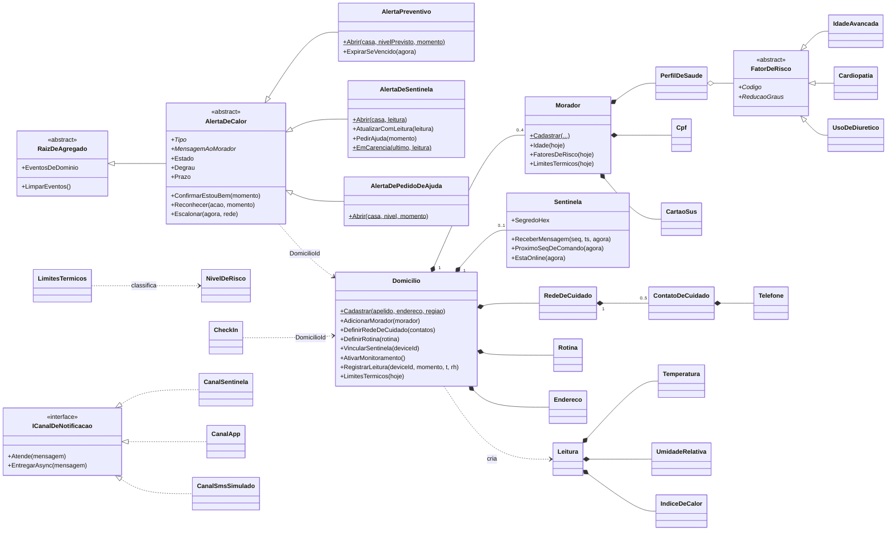
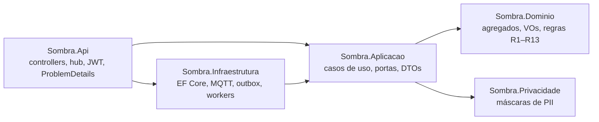

# Sombra · Core API (C#)

> O coração do **Sombra**, alerta de calor extremo para pessoas idosas que moram sozinhas: casas, moradores, rede de
> cuidado, Sentinelas, leituras, alertas, check-ins e o escalonamento em degraus. .NET 10, ASP.NET Core, EF Core com
> PostgreSQL, MQTT assinado e SignalR. Disciplina **C# Software Development** · spec
> [`01-csharp-core-api.md`](../../docs/specs/01-csharp-core-api.md) · fase F1 do [plano](../../docs/PLANO.md).

## Ficha da CitizenTech

| Campo | Conteúdo |
|---|---|
| **Nome** | Sombra |
| **Cidade** | São Paulo/SP. Dados climáticos da estação INMET A701 (Mirante de Santana) |
| **Cidadão beneficiado** | Pessoa idosa que mora sozinha e sua rede de cuidado: família, vizinhos e agentes comunitários de saúde |
| **Problema, em uma frase** | *Em ondas de calor, idosos que moram sozinhos em São Paulo não percebem o perigo dentro de casa, e a família só fica sabendo quando já é tarde.* |
| **O papel do Core** | Recebe as leituras assinadas da Sentinela, calcula o índice de calor com os limites pessoais de cada morador, abre o alerta, pede o "estou bem" e, sem resposta, avisa a rede em degraus: lembrete leve à filha, "pode dar uma olhada?" à vizinha e, só então, a rede toda |
| **Indicador de impacto** | Tempo mediano entre o alerta e o "estou bem" (meta < 15 min) · % de alertas resolvidos antes de chamar a rede toda · alarmes desnecessários por semana. O Core calcula os três em `GET /api/v1/painel/resumo` |
| **ODS** | 3 (3.d) · 10 (10.2) · 11 (11.5) · 13 (13.1) |

## Rubrica → onde está → evidência

| Critério | Como o Core atende | Onde | Evidência |
|---|---|---|---|
| **POO** (3,0) | Agregados encapsulados: setters privados, fábricas que recusam estado inválido, métodos com nome de negócio. **Herança e polimorfismo:** `AlertaDeCalor` abstrato com três tipos, cada um com `Tipo`, `MensagemAoMorador` e `Escalonar` próprios; `FatorDeRisco` (idade avançada, cardiopatia, diurético) reduzindo os limites térmicos; `ICanalDeNotificacao` com três canais; `WorkerPeriodico` com três workers. Value objects (`Cpf`, `CartaoSus`, `Telefone`, `Endereco`, `Temperatura`, `UmidadeRelativa`, `IndiceDeCalor`, `LimitesTermicos`) e eventos de domínio | [`Sombra.Dominio`](sources/Sombra.Dominio/), [`Canais.cs`](sources/Sombra.Infraestrutura/Mensageria/Canais.cs), [`WorkerPeriodico.cs`](sources/Sombra.Infraestrutura/Workers/WorkerPeriodico.cs) | [diagrama de classes](#diagrama-de-classes) · 86 testes de domínio, 91,8% de cobertura |
| **Web API** (2,5) | 31 operações (28 em `/api/v1`, mais saúde e versão), com 201 + `Location`, 204, 400 por campo, 401, 403, 404, 409, 422 com o código da regra e 429. Erros em ProblemDetails (RFC 9457) com `correlationId`, DTOs validados com DataAnnotations, paginação e filtros, JWT com papéis (Cuidador só nas casas dele), limite de requisições, `/health/live`, `/health/ready`, `/version`. OpenAPI 3.1 com resumo, tag, exemplo e 4xx em todo endpoint, no Scalar | [`Sombra.Api`](sources/Sombra.Api/), [contrato](../../docs/contratos/core-api.openapi.json) | [Scalar](docs/evidencias/scalar.png) · [operações com os 4xx](docs/evidencias/scalar-operacoes.png) · 7 testes de API |
| **EF Core + LINQ** (1,5) | Npgsql com nomes em snake_case, `IEntityTypeConfiguration` por agregado, tipos complexos para endereço e rotina, conversores para os VOs, alertas em TPH, rede de cuidado em `jsonb`, **6 migrações** (Inicial · AlertasECheckIns · RedeDeCuidadoEIndices · SeedDemo · Usuarios · MqttOutboxESeguranca). LINQ: `GroupBy` por nível, degrau e bairro traduzidos para SQL, mediana até o check-in, projeções para DTO, `AsNoTracking` e paginação | [`Persistencia`](sources/Sombra.Infraestrutura/Persistencia/), [`ConsultasDoPainel.cs`](sources/Sombra.Infraestrutura/Persistencia/ConsultasDoPainel.cs) | [migrações e tabelas](docs/evidencias/migracoes.png) · 8 testes num PostgreSQL real |
| **Async/Await** (1,0) | Async de ponta a ponta com `CancellationToken`. `BackgroundService`s: ingestão MQTT com `Channel<T>` entre o broker e o processamento, escalonador a cada 15 s, monitor de previsão e publicador do outbox. `Task.WhenAll` consulta o Clima de todas as regiões em paralelo. SignalR empurra os eventos sem polling | [`IngestaoMqttWorker.cs`](sources/Sombra.Infraestrutura/Mqtt/IngestaoMqttWorker.cs), [`Workers.cs`](sources/Sombra.Infraestrutura/Workers/Workers.cs), [`AvaliarPrevisoes.cs`](sources/Sombra.Aplicacao/Alertas/AvaliarPrevisoes.cs), [`HubDoSombra.cs`](sources/Sombra.Api/TempoReal/HubDoSombra.cs) | o [roteiro de ponta a ponta](sources/Sombra.Api.IntegrationTests/RoteiroTests.cs) roda com os workers num Mosquitto real |
| **Qualidade** (2,0) | Cinco camadas com **testes de arquitetura** (NetArchTest), StyleCop, analisadores e `.editorconfig` do CP06, warnings como erro, **`Invoke-CodeQuality.ps1` do professor, sem alteração: 100/100**, cobertura do domínio ≥ 90% no CI, XML docs em todo tipo público, migrações conferidas no CI, logs JSON com correlação e nenhum dado pessoal | [`ArquiteturaTests.cs`](sources/Sombra.ArchitectureTests/ArquiteturaTests.cs), [CI](../../.github/workflows/ci.yml) | [quality 100/100](docs/evidencias/quality.png) · [140 testes](docs/evidencias/testes.png) · [cobertura](docs/evidencias/cobertura.png) |

## Diagrama de classes

O domínio (`Sombra.Dominio`) e os pontos de polimorfismo das outras camadas.



## Camadas



As setas são as únicas dependências permitidas, e os [testes de arquitetura](sources/Sombra.ArchitectureTests/ArquiteturaTests.cs)
quebram o build se alguém criar outra. As regras de negócio (R1 a R13) ficam no domínio, cada uma com teste; a lista
está na [spec](../../docs/specs/01-csharp-core-api.md#regras-de-negócio-no-domínio-cada-uma-com-teste).

## Como rodar

Precisa de Docker, `make` e, para o simulador, `uv`. Todo comando `dotnet` roda na imagem oficial do SDK 10.0.404, igual
ao CI, então não precisa do .NET instalado.

```bash
make env                 # na raiz: cria o .env e gera os segredos (banco, JWT, senha da demo, Sentinela)
make up                  # sobe PostgreSQL, Mosquitto e o Core; o Core migra o banco ao subir
make db-reset            # apaga o banco local e o cria do zero: as 6 migrações e o seed da demonstração
```

- **API e Scalar:** <http://localhost:5080/scalar/v1> (o OpenAPI em `/openapi/v1.json`)
- **Saúde e versão:** `/health/live`, `/health/ready` (banco e broker) e `/version`
- **Contas da demonstração:** `ana.filha@demo.sombra` (Cuidadora da casa da Dona Lurdes), `marcos.filho@demo.sombra`,
  `operador@demo.sombra` e `admin@demo.sombra`. A senha é o `Demo__Senha` do `.env`; ela nunca fica no repositório. No
  Scalar, faça `POST /api/v1/auth/login` e cole o token no botão de autenticação.
- **A Sentinela simulada:** `make sim CENARIO=onda-de-calor` (também `sem-resposta`, `pedido-de-ajuda`,
  `payload-adulterado`). Ela publica telemetria assinada para a casa da Dona Lurdes. Para o caminho B caber num vídeo,
  `POST /api/v1/demo/relogio/avancar` (Admin, só em Development e Demo) adianta o relógio do Core.

Dentro de `services/core-api`:

```bash
make test                # 140 testes: domínio, aplicação, arquitetura e integração (PostgreSQL e Mosquitto via Testcontainers)
make coverage            # cobertura do domínio, com o mínimo de 90% (o CI barra abaixo disso)
make coverage-report     # relatório HTML da suíte inteira em artifacts/coverage/relatorio
make quality             # o pipeline de qualidade do professor (scripts/Invoke-CodeQuality.ps1)
make migration NOME=X    # gera uma migração; make migration-check confere que nada ficou pendente
make openapi             # regenera docs/contratos/core-api.openapi.json a partir da API
```

## Integrantes

| Nome | RM |
|---|---|
| André Nakamatsu Rocha | RM555004 |
| João Marcelo Furtado Romero | RM555199 |
| Matheus Rivera Montovaneli | RM555499 |

Nenhum dado pessoal real: as pessoas do seed são fictícias e os CPFs e Cartões SUS são sintéticos.
